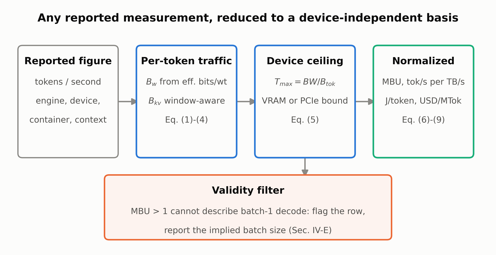

# Normalizing Local LLM Benchmarks

A memory-traffic normalization framework for local LLM inference on consumer GPUs, together with the full reproduction package for the accompanying systematic review, *Local LLM Inference on Consumer-Class GPUs*.



## The problem

Tokens per second figures for local LLMs are almost impossible to compare. One blog post runs a 4-bit model on an RTX 4090 with llama.cpp, another runs a differently quantized build of the "same" model on an RTX 5090 with vLLM at concurrency 8, and a third reports a number that silently includes prompt processing. The headline numbers differ, but the setups differ even more.

Single-stream decoding on a consumer GPU is memory-bandwidth bound. Every generated token requires streaming the model weights, plus the live KV cache, through the memory bus. That makes it possible to convert a reported throughput into a hardware-independent quantity and to check whether the reported number is physically plausible at all.

## What the framework does

Given a reported measurement and the parameters its source states, the framework computes:

| quantity | meaning |
|---|---|
| Bytes per token | weight traffic plus KV cache traffic for one decoded token |
| Roofline ceiling | the highest tokens per second the GPU's memory bandwidth allows |
| MBU (Model Bandwidth Utilization) | achieved memory traffic divided by peak bandwidth |
| Bandwidth-normalized throughput | tokens per second per TB/s of memory bandwidth |
| Energy per token | joules per generated token |
| Cost per million tokens | electricity plus optional hardware amortization, in USD |

On top of these sits a **validity filter**. If a figure presented as single-stream decoding implies an MBU above 1, it cannot be batch-1 decoding on that device. Something in the description is wrong or missing, typically a hidden batch size or a throughput that was measured over a window that includes prefill.

The filter is deliberately conservative. For measurements whose sources withhold too much information, it reports `INDETERMINATE` instead of guessing: it computes the full range of per-token traffic consistent with what the source states and checks whether that range straddles MBU = 1. No row ever asserts that a measurement is wrong.

## Key results

The nine verified measurements in the corpus, and the analyses built on them, support five findings.

1. **The batch-1 ceiling check recovers hidden batching.** Three RTX 50-series rows exceed the single-stream roofline (MBU between 1.34 and 1.50). Their source documents them as concurrency 8, so the filter recovers a fact that the throughput number alone does not carry.
2. **Normalization explains most of an apparent engine gap.** On matched hardware and model, TensorRT-LLM shows about 1.66x the raw throughput of llama.cpp. After accounting for the different bits per weight of the two containers, the MBU ratio is about 1.58x.
3. **The engine result survives phase contamination.** Prefill makes up 80% of the tokens in the Menlo workload, but it is roughly sixty times faster per token than decode, so its share of the wall clock is small. `phasebound.py` bounds the contamination with Amdahl's law.
4. **Energy per token is measured, not inferred.** On an RTX 4060 Ti 16GB, joules per token span 0.556 to 2.485 across 1B to 7B models.
5. **Most quantization differences are inside the noise.** Using the llama.cpp k-quants evaluation on Llama-3.1-8B-Instruct, differences down to Q4_0 sit within an empirical noise floor derived from the table itself (Q5_0 and Q5_K_S have identical bit width and perplexity, yet different task scores). Only the Q3 family shows robust degradation.

## Repository layout

| file | purpose |
|---|---|
| `normalize.py` | the framework: equations (1) to (9), GPU table, model registry, measured bits per weight |
| `corpus.py` | the nine verified measurements and findings F1 to F5 |
| `candidates.py` | the nine non-normalizable measurements used to test the filter |
| `quality.py` | quantization accuracy from two independent primary sources |
| `uncertainty.py` | sampling and attribution noise floors |
| `frontier.py` | VRAM feasibility across models, containers and context lengths |
| `sensitivity.py` | the filter's detection boundary |
| `phasebound.py` | Amdahl bound on prefill contamination of the engine result |
| `from_csv.py` | command line tool that normalizes your own measurements |
| `figures.py`, `fig1_prisma.py`, `figsave.py` | figure generation (PNG at 600 dpi or better, plus vector PDF) |
| `gen_tables.py` | builds `paper/tables.json` from the analysis output |
| `gen_ref_audit.py` | builds the per-reference verification record |
| `audit.py` | checks the manuscript against every claim and review item |
| `test_normalize.py` | regression tests, including a double-averaging guard |
| `paper/` | manuscript sources (Node and `docx`) |
| `verify/` | verification log and reference audit |
| `t*.csv` | generated result tables |

## Normalize your own measurement

```bash
python3 from_csv.py --template > my_measurements.csv   # column list with comments
python3 from_csv.py --from-csv my_measurements.csv     # MBU, ceiling and filter verdict
python3 from_csv.py --reproduce-table2                 # worked example
```

The CSV columns are exactly the fields of the paper's reporting standard (model, quantization container, engine, GPU, prompt and generation lengths, batch size, phase, and so on). A row with a missing field is never given a default. The tool names the missing field and the equation it blocks. When the batch size is above one, it prints two verdicts: the one the stated batch supports, and the one a reader would reach on meeting the same figure presented as single-stream.

## Reproduce everything

```bash
python3 test_normalize.py        # regression tests, run this first
python3 corpus.py                # verified corpus and findings F1-F5
python3 candidates.py            # the filter on non-normalizable figures
python3 quality.py               # quantization containers
python3 uncertainty.py           # the two noise floors
python3 frontier.py              # VRAM feasibility frontier
python3 sensitivity.py           # filter detection boundary
python3 phasebound.py            # mixed-phase bound on the engine ratio
python3 figures.py               # figures
python3 gen_tables.py            # writes paper/tables.json from the CSVs
python3 gen_ref_audit.py         # verify/REFERENCE_AUDIT.md
python3 audit.py                 # checks the manuscript against every claim
cd paper && node build.js        # writes the .docx
```

`gen_tables.py` is the link between analysis and manuscript. No number in the paper is typed by hand, so re-run it after any change to the analysis scripts.

**Note on paths.** Several scripts still contain absolute output paths from the original authoring environment (`/home/claude/review`). Point those at your checkout, or run from a matching directory, before executing the pipeline.

## Design conventions

**Context is mean cache occupancy.** The mean cache depth over a generation is `C̄ = L_prompt + L_gen / 2`, computed by `ctx_bar()`. The averaging happens there and nowhere else. `bytes_per_token()` evaluates the cache at that depth and does not halve again. An earlier revision averaged twice and understated cache traffic by nearly a factor of two on prompt-heavy workloads, and `test_no_double_averaging()` now guards against it.

**Bits per weight are measured, not named.** A container like "Q4_K_M" does not have a single width, because the share of parameters left in full precision (embeddings, output projection) varies with the model. Where a published artifact exists for a (model, container) pair, `BPW_MEASURED` derives the width from its file size. The generic table is only a fallback.

**Phase has three values.** `decode` means output tokens over decode time. `decode/total` means output tokens over whole-call time, which understates decode speed, so any derived MBU is a lower bound. `mixed` means all tokens over whole-call time.

**Sliding-window attention is modeled.** Gemma 3 and gpt-oss cap the cache of most layers at a window size, so their KV traffic stops growing linearly with context. The model registry carries this explicitly.

**MoE models use active parameters.** Weight traffic for a mixture-of-experts model is computed from the activated parameters when experts are resident, and a separate resident-sweep reading is used when the batch is large enough to touch most experts.

## Data provenance

Every throughput figure, file size and architectural constant was read from its primary source (a paper, a vendor report, a model's `config.json`, or a published artifact) and traced in `verify/VERIFICATION_LOG.md`. Rows whose throughput, container, batch size, context or phase could not be confirmed were removed instead of filled in. All 70 references are recorded with the route each was verified by in `verify/REFERENCE_AUDIT.md`.

## Figures

`figsave.py` controls output resolution. It measures each saved PNG and re-saves at a higher dpi if tight cropping dropped it below 600 dpi at the width the manuscript places it. A vector PDF is written next to every PNG and is preferable for camera-ready use.

## Requirements

Python 3.11 or newer with pandas, numpy and matplotlib. Node 18 or newer with the `docx` package for building the manuscript. No GPU is needed: the package normalizes published measurements and does not run inference.

## License

MIT. See [LICENSE](LICENSE).
